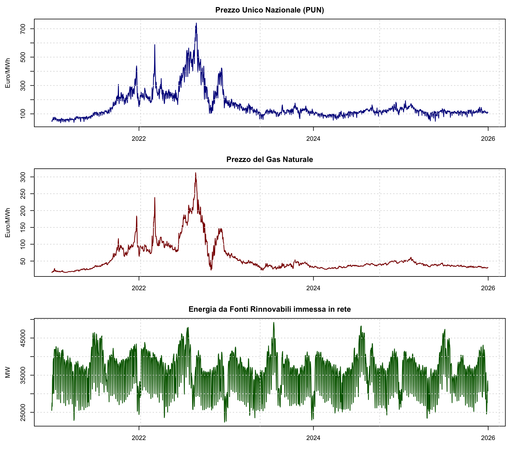

# Tra Vecchie e Nuove Fonti. Modellazione Econometrica del Mercato Energetico Italiano

Analisi econometrica di serie storiche sul mercato elettrico italiano (2021–2025):
relazioni dinamiche tra **prezzo dell'elettricità (PUN)**, **prezzo del gas naturale**
ed **energia da fonti rinnovabili**.

Progetto sviluppato per il corso *Modelli Statistici per Dati Economici*
(Scienze Statistiche) da **Giorgia Caicchiolo** e **Gabriele Paganelli**.

> 🇮🇹 Italiano qui sotto · 🇬🇧 [English version below](#-english-version)



---

## Contesto e obiettivo

Nel quinquennio 2021–2025 il mercato elettrico italiano ha attraversato una fase di
forte turbolenza (crisi energetica del 2022, crescita delle rinnovabili). L'obiettivo
è capire **come le tre serie si influenzano a vicenda**: se esiste un legame stabile di
lungo periodo tra gas ed elettricità, e quanto velocemente il sistema reagisce a shock
sul costo del gas o sulla produzione rinnovabile.

## Dataset

Tutti i dati provengono da **fonti pubbliche istituzionali**. Sono aggregati a
**frequenza giornaliera** sul periodo **2021-01-01 → 2025-12-31** (1826 osservazioni).

| Serie | Descrizione | Frequenza grezza | Fonte |
|---|---|---|---|
| **PUN** [€/MWh] | Prezzo Unico Nazionale dell'energia elettrica | Oraria | [GME – Esiti MGP Elettricità](https://www.mercatoelettrico.org/it-it/Home/Esiti/Elettricita/MGP/Statistiche/DatiStorici) |
| **Gas** [€/MWh] | Prezzo del gas naturale (MGP-GAS) | Giornaliera | [GME – Storico Mercato Gas](https://www.mercatoelettrico.org/en-us/Home/Results/Gas/MGS/StatisticalData/HistoricalData) |
| **Rinnovabili** [MW] | Energia da fonti rinnovabili immessa in rete (Total Load) | 15 minuti | [Terna – Download Center](https://dati.terna.it/en/download-center#/load/total-load) |

**I dati grezzi non sono versionati** in questo repository (file pesanti, ~40 MB, e
riscaricabili liberamente dai portali). Il repository contiene invece la serie
giornaliera già processata in [`data/processed/energy_daily.csv`](data/processed/energy_daily.csv),
generata in modo **riproducibile** da [`R/01_preprocessing.R`](R/01_preprocessing.R).
Per rigenerarla da zero, vedi [Come riprodurre](#come-riprodurre).

## Metodo

L'analisi procede per fasi, dall'univariato al multivariato:

1. **Modelli SARIMA** univariati: isolamento della componente stocastica e della
   stagionalità settimanale di ciascuna serie (su scala logaritmica).
2. **Cointegrazione**: test ADF, causalità di Granger, test di Johansen, stima di
   **VECM**, procedura di **Engle-Granger** e **DOLS** per il legame di lungo periodo.
3. **Transfer Function Models**: risposta dinamica del PUN a impulsi su gas e rinnovabili.
4. **Modelli VAR**: interdipendenze multivariate, con IRF ortogonalizzate, FEVD e Granger.
5. **Confronto predittivo**: rolling forecast a 14 giorni e test di **Diebold-Mariano**.

## Risultati

*(I valori riportati provengono dal report finale; il documento completo con tutte le
tabelle e i grafici è in [`reports/Caicchiolo_Paganelli.pdf`](reports/Caicchiolo_Paganelli.pdf).)*

- **Legame di lungo periodo gas → PUN**: confermata la cointegrazione, con
  **elasticità stimata ≈ 0.84**. Il PUN assorbe gli squilibri con una **velocità di
  aggiustamento ≈ 13% per periodo**; il gas risulta **debolmente esogeno** (guida il
  sistema senza reagire agli squilibri).
- **Rinnovabili**: stazionarie nei livelli, **escluse dalla relazione di cointegrazione**;
  il loro effetto sul PUN agisce prevalentemente nel breve periodo.
- **Transfer Function gas → PUN**: impatto immediato **+0.54%** seguito da un effetto
  ritardato **+0.24%**, a conferma del ruolo dominante del gas.
- **VAR(7)** ristretto: la decomposizione della varianza (FEVD) attribuisce al gas un
  **10–15%** della variabilità del PUN e alle rinnovabili **~5%**.
- **Previsione**: il modello **Transfer Function con il gas come input (TFM_Gas)** ottiene
  RMSE e MAE inferiori su ogni orizzonte; il test di Diebold-Mariano ne conferma la
  superiorità in modo statisticamente significativo.

**In sintesi:** il prezzo del gas resta il principale driver del PUN; l'impatto delle
rinnovabili è secondario e mediato da meccanismi di dispacciamento più complessi.

## Come riprodurre

```bash
# 1. Installare i pacchetti R necessari
Rscript install.R

# 2. (Opzionale) Rigenerare la serie processata dai dati grezzi.
#    Scaricare prima gli Excel dai portali (tabella "Dataset") in data/raw/
#    mantenendo i nomi file attesi, poi:
Rscript R/01_preprocessing.R      # -> data/processed/energy_daily.csv

# 3. Compilare il report (richiede una distribuzione LaTeX, es. TinyTeX)
Rscript -e 'rmarkdown::render("notebooks/Report-finale.Rmd")'
```

Il report si compila anche **senza scaricare i dati grezzi**, perché legge direttamente
`data/processed/energy_daily.csv` già incluso nel repository.

## Struttura del repository

```
.
├── data/
│   ├── raw/                    # dati grezzi Excel (NON versionati, vedi .gitignore)
│   └── processed/
│       └── energy_daily.csv    # serie giornaliera allineata (input delle analisi)
├── notebooks/
│   └── Report-finale.Rmd       # report completo (analisi + testo)
├── R/
│   └── 01_preprocessing.R      # grezzo -> processato (riproducibile)
├── reports/
│   ├── Caicchiolo_Paganelli.pdf   # report finale renderizzato
│   └── figures/
│       └── serie_storiche.png
├── install.R                   # installazione pacchetti R
├── LICENSE                     # MIT
└── README.md
```

## Tecnologie

**R** · R Markdown · SARIMA/ARIMA (`forecast`) · VAR/VECM (`vars`, `urca`) ·
cointegrazione e DOLS (`dynlm`, `lmtest`) · transfer function (`MTS`) ·
data wrangling (`tidyverse`, `readxl`, `lubridate`).

## Nota sull'uso dell'AI

Nella stesura del progetto originale sono stati usati strumenti di AI generativa
(Claude, Gemini, ChatGPT) per brainstorming, individuazione delle banche dati,
automazione di parti di codice (importazione/pulizia dati, ciclo di rolling forecast),
supporto alla scrittura e validazione delle conclusioni.

---

## 🇬🇧 English version

**Between Old and New Sources — Econometric Modelling of the Italian Energy Market**

Time-series econometric analysis of the Italian electricity market (2021–2025), studying
the dynamic relationships between the **electricity price (PUN)**, the **natural gas
price**, and **renewable energy** fed into the grid. Coursework project for *Statistical
Models for Economic Data* by Giorgia Caicchiolo and Gabriele Paganelli.

### Context and goal
Over 2021–2025 the Italian power market went through severe turbulence (2022 energy
crisis, growth of renewables). The goal is to understand **how the three series influence
each other**: whether a stable long-run link between gas and electricity exists, and how
quickly the system reacts to shocks in gas cost or renewable output.

### Dataset
All data come from **public institutional sources** (GME, Terna), aggregated to **daily**
frequency over **2021-01-01 → 2025-12-31** (1826 observations). See the table in the
Italian section for series, frequencies and links. **Raw data are not versioned** here
(large, freely re-downloadable); the repo ships the reproducibly processed daily series
[`data/processed/energy_daily.csv`](data/processed/energy_daily.csv), built by
[`R/01_preprocessing.R`](R/01_preprocessing.R).

### Method
Univariate **SARIMA** → **cointegration** (ADF, Granger, Johansen, VECM, Engle-Granger,
DOLS) → **Transfer Function Models** → **VAR** (IRF, FEVD, Granger) → out-of-sample
**rolling forecast** with the **Diebold-Mariano** test.

### Results
- Confirmed **long-run gas → PUN cointegration**, elasticity **≈ 0.84**, adjustment speed
  **≈ 13% per period**; gas is **weakly exogenous**.
- **Renewables** are stationary in levels and **excluded from the cointegrating relation**;
  their effect on PUN is mainly short-run.
- **Transfer function gas → PUN**: immediate impact **+0.54%**, lagged **+0.24%**.
- Restricted **VAR(7)**: FEVD attributes **10–15%** of PUN variance to gas, **~5%** to
  renewables.
- The **transfer-function model with gas as input (TFM_Gas)** is the best forecaster
  across all horizons (Diebold-Mariano significant).

**Takeaway:** gas price remains the main driver of the PUN; the impact of renewables is
secondary and mediated by more complex dispatching mechanisms.

### How to reproduce
See the commands in the Italian [Come riprodurre](#come-riprodurre) section. The report
compiles without downloading raw data, as it reads the included processed CSV.

### Tech stack
**R** · R Markdown · `forecast` · `vars` · `urca` · `dynlm` · `lmtest` · `MTS` ·
`tidyverse` · `readxl` · `lubridate`.

### License
[MIT](LICENSE) © 2026 Giorgia Caicchiolo, Gabriele Paganelli.
